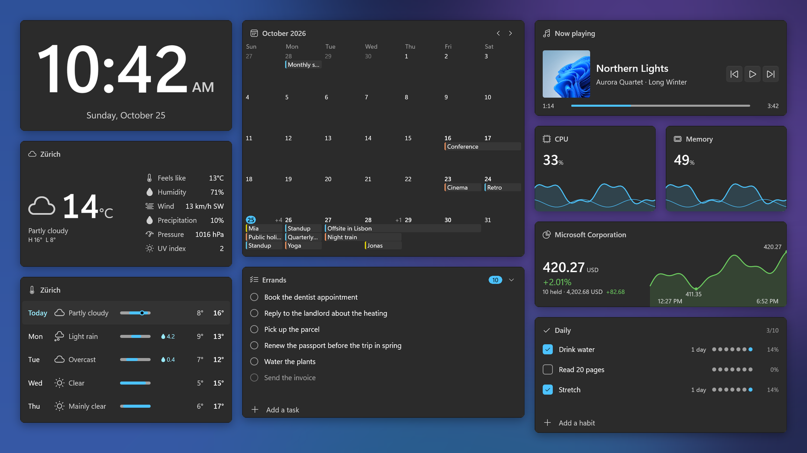
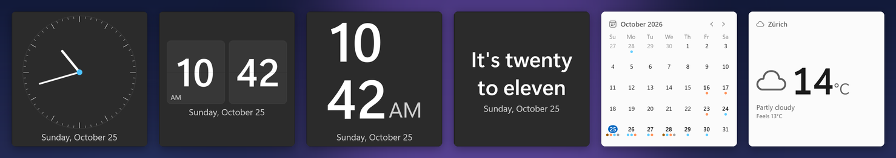
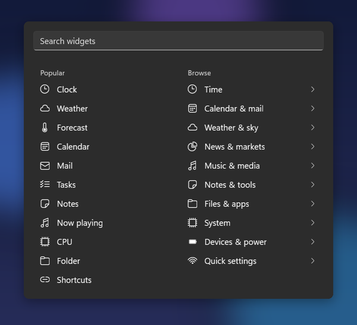

# Themia

**Widgets for your Windows desktop.** The clock, the weather, your calendar, mail, tasks, notes,
music and how your PC is doing, right on your wallpaper, behind your windows.

[Website](https://themia.app) · [Get help](#help-and-support) · [Report a problem](https://github.com/crazy-rabbit-software/themia/issues/new/choose) · [Contribute and get Pro for free](#contribute-and-get-pro-for-free)

## What Themia does

Themia puts small, good-looking panels on your desktop that show what you care about. They sit
behind your windows like your wallpaper, so they never get in the way. Minimise everything (or press
**Win + D**) and there they are.

- **79 widgets to choose from.** Clocks, weather, calendars, mail, to-do lists, notes, music,
  photos, shortcuts to your apps and folders, and meters for your CPU, memory, battery and network.
- **They fit any size.** Make a widget bigger and it shows more; make it smaller and it keeps what
  matters most.
- **Make it yours.** Many widgets come in several styles, and you choose the colours, transparency,
  borders and corners. Light and dark mode follow Windows.
- **Several layouts.** Keep one desktop for work and one for the evening, and switch with a click.
  Every screen can have its own.
- **Your accounts, on your PC.** Mail, calendars and tasks connect directly to Microsoft (Outlook),
  Google, iCloud or your own mail server. Nothing goes through us.
- **Private by design.** No ads, no tracking, no analytics, and no Themia account to create.
- **Light on your PC.** Built for Windows 11, it starts fast and does nothing while nothing changes.
- **In your language.** Available in 30 languages.

### Pick a style

### Add widgets in seconds

| Category | A few of the widgets |
|---|---|
| Time | Clock, alarm, timer, stopwatch, Pomodoro, focus session |
| Calendar and mail | Calendar, week planner, next meeting, mail, contacts, tasks |
| Weather and sky | Weather now, forecast, rain in the next hour, air quality, sun and moon |
| News and markets | Stocks, exchange rates, news feeds, quote of the day |
| Music and media | Now playing, volume, mixer, photo gallery, camera stream |
| Notes and tools | Notes, scratchpad, clipboard history, habit tracker, notifications |
| Files and apps | App shortcuts, folders, recent files, Recycle Bin, drives |
| System | CPU, memory, graphics card, disk, network, screen time |
| Devices and quick settings | Battery, brightness, Wi-Fi, Bluetooth, Do not disturb, night light, shut down and restart |

## Get Themia

Themia is available from the **Microsoft Store** for Windows 11. The Store installs it and keeps
it up to date. See [themia.app](https://themia.app) for the link.

- **Free:** every widget, up to 20 widgets and 2 layouts.
- **Themia Pro:** unlimited widgets and layouts. One purchase, no subscription.

If you ever go over the free limit, nothing you made is deleted or hidden.

### Getting started

1. After installing, Themia starts with a few widgets on your desktop.
2. Press **Ctrl + Alt + W** (or double-click a widget) to start editing.
3. Click **Add widget**, pick one, and click on your desktop to place it.
4. Drag widgets to move them, drag their edges to resize, and **right-click** one to change its
   style, colours and options.
5. Click **Done** when you are happy with it.

## Help and support

- **Something not working?** [Report a problem](https://github.com/crazy-rabbit-software/themia/issues/new?template=bug-report.yml).
  Tell us which widget, what you did and what happened. A screenshot helps a lot.
- **An idea or a widget you'd love?** [Suggest an improvement](https://github.com/crazy-rabbit-software/themia/issues/new?template=feature-request.yml)
  or [request a widget](https://github.com/crazy-rabbit-software/themia/issues/new?template=widget-request.yml).
- **Want to chat or ask a question?** Join the [Discussions](https://github.com/crazy-rabbit-software/themia/discussions).
- **Something private** (a purchase, your account, or anything you'd rather not post publicly)?
  Email [support@themia.app](mailto:support@themia.app).

Before you open a new report, have a quick look at the [open issues](https://github.com/crazy-rabbit-software/themia/issues):
someone may have reported it already, and a thumbs-up there tells us it matters to you too.
Issues are public, so never post passwords or other private information.

## Contribute and get Pro for free

Themia gets better because people tell us what's wrong and what's missing. **Anyone who
contributes to Themia, in any way, gets a free Themia Pro licence.** You don't need to be a
programmer. For example:

- **Report a bug** you ran into, with the steps to see it again.
- **Suggest a feature or a new widget.**
- **Improve a translation** in your language, or tell us where the wording is wrong.
- **Test a fix** and tell us whether it works for you.
- **Help other people** in the issues or the Discussions.
- **Share your setup** with a screenshot of your desktop in the Discussions.
- **Write code**: fix a bug or build a widget (see [CONTRIBUTING.md](CONTRIBUTING.md)).

To get your licence, mention it in your issue or pull request, or email
[support@themia.app](mailto:support@themia.app) with a link to what you did. Thank you!

## For developers

Themia's source code is public. You can read it, build it yourself and send improvements.
[CONTRIBUTING.md](CONTRIBUTING.md) explains how to build Themia, how it works inside and how to
send a pull request.

The source is available under the [Elastic License 2.0](LICENSE): you may read, build, change and
share it, but not remove or work around the Pro licence check, remove the notices, or offer Themia
as a hosted service. That makes it source available, not open source; the LICENSE file is the
binding text. The Themia name and logo are not covered by the licence, so give a modified build its
own name and icon. Third-party material is listed in [THIRD-PARTY-NOTICES.md](THIRD-PARTY-NOTICES.md).

---

Made by [Lometics GmbH](https://lometics.com) · [Privacy policy](https://lometics.com/en/legal/privacy/) · © 2026 Lometics GmbH

